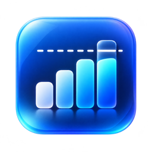
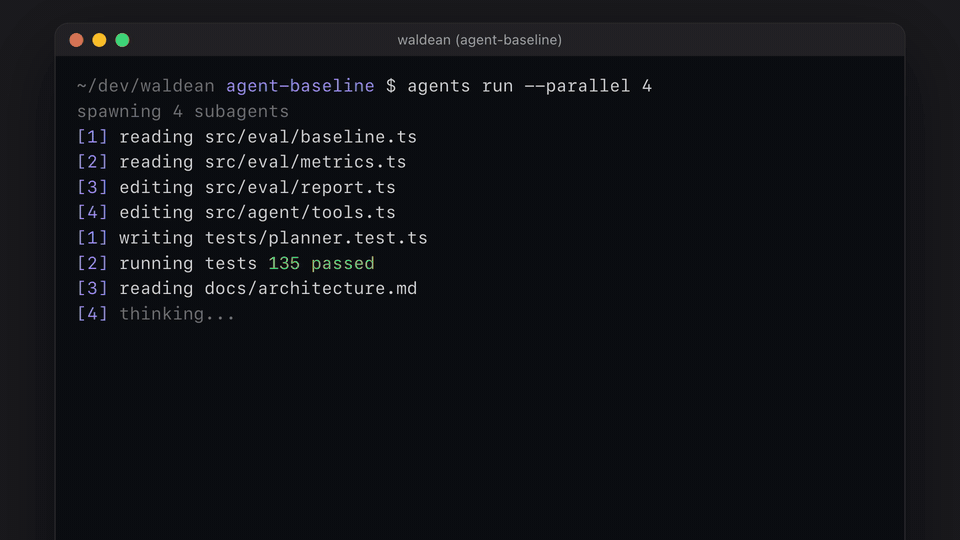
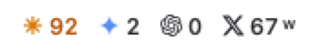
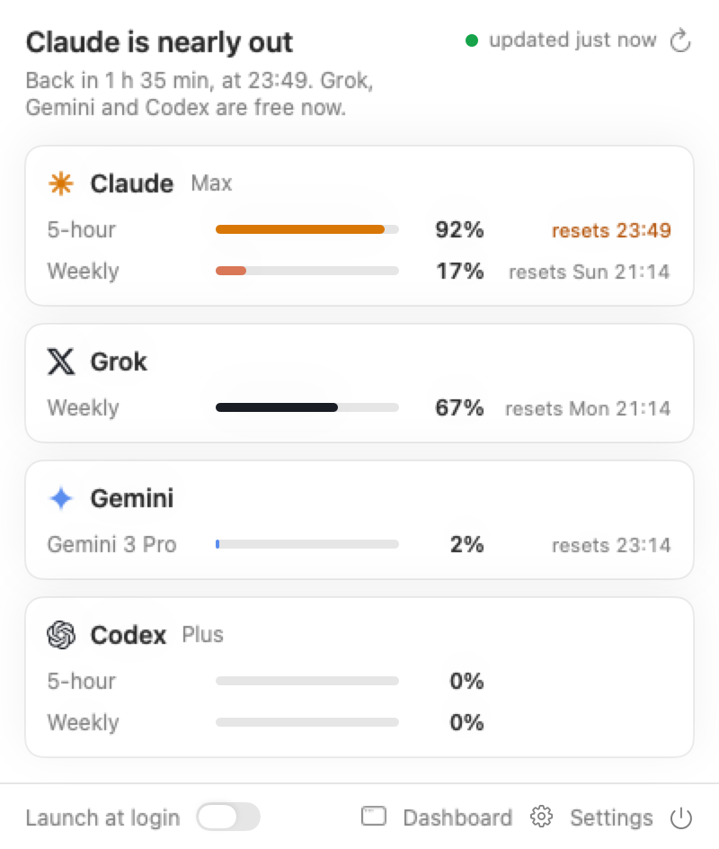
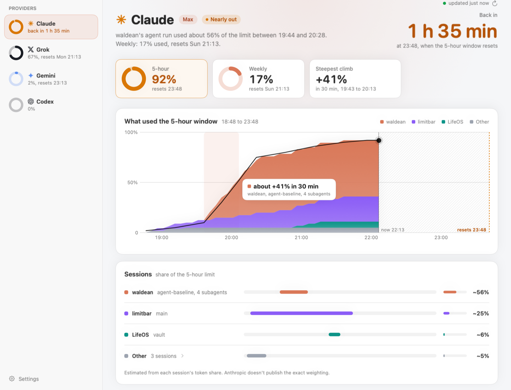

<p align="center"></p>

<h1 align="center">limitbar</h1>

<p align="center">
  See how much of your Claude, Codex, Gemini and Grok limits you have left, right in the macOS menu bar.
</p>

<p align="center">
  <a href="https://github.com/Wake360/limitbar/releases"><b>Download for macOS</b></a>
  &nbsp;|&nbsp;
  <a href="#windows-and-linux">Windows and Linux</a>
  &nbsp;|&nbsp;
  <a href="#privacy">Privacy</a>
</p>

<p align="center">
  <a href="docs/demo.mp4"></a>
</p>

limitbar signs in with the credentials your CLIs and browser already have. No accounts, no API keys, no servers. Requests go straight from your Mac to each provider.

## What you get

**One glance in the menu bar.** Each signed-in provider shows its logo and its tightest limit in percent. The number turns amber at 80%.

<picture>
  <source media="(prefers-color-scheme: dark)" srcset="docs/menubar-dark.png">
  
</picture>

**A plain answer when you click.** The popover tells you in one line whether you can keep working ("All clear", "Claude is nearly out, back in 1 h 35 min"). Below it, a card per provider with its 5-hour, weekly and daily windows and when each one resets.

<picture>
  <source media="(prefers-color-scheme: dark)" srcset="docs/popover-dark.png">
  
</picture>

**What used up your limit.** The dashboard charts the current window and splits it by session, so you see which project or agent run burned through it.

<picture>
  <source media="(prefers-color-scheme: dark)" srcset="docs/dashboard-dark.png">
  
</picture>

For Claude the split is estimated from Claude Code session logs. For Codex it is measured from Codex session logs.

It refreshes every 5 minutes (configurable), when you open the popover, and on Cmd+R. The last values are cached, so the bar shows data right after launch.

## Install

1. Download `limitbar-<version>.dmg` from [Releases](https://github.com/Wake360/limitbar/releases). It runs on Apple silicon and Intel Macs with macOS 15 or later.
2. Open the DMG and drag limitbar into Applications.
3. Open limitbar. The app is not notarized by Apple, so macOS blocks the first launch. Go to System Settings > Privacy & Security, find "limitbar was blocked", and click Open Anyway.

limitbar has no Dock icon. Look for it in the menu bar. To start it at login, turn on "Launch at login" at the bottom of the popover.

<details>
<summary>Verify the download, or skip the Gatekeeper step from the terminal</summary>

Each release has a `limitbar-<version>.dmg.sha256` file. In the download folder, run:

```sh
shasum -a 256 -c limitbar-<version>.dmg.sha256
```

and look for `OK`.

Instead of step 3, you can clear the block with:

```sh
xattr -dr com.apple.quarantine /Applications/limitbar.app
```

</details>

## Connect your providers

You don't set anything up in limitbar. Sign in to the tools you already use and it picks them up. Providers you don't use stay hidden.

| Provider | How to sign in | Where limitbar reads it |
| --- | --- | --- |
| Claude | Install [Claude Code](https://docs.claude.com/en/docs/claude-code) and run `claude` | Keychain item `Claude Code-credentials` |
| Codex | Install the [Codex CLI](https://github.com/openai/codex) and run `codex login` | `~/.codex/auth.json` |
| Gemini | Open Antigravity and sign in | Keychain item from Antigravity (service `gemini`, account `antigravity`) |
| Grok | Paste your `sso` cookie in Settings (recommended), or log in to grok.com in Chrome, Brave, Arc, Edge or Chromium | The pasted cookie, or the browser's cookie store |

### What macOS will ask

**Keychain prompts.** The first time limitbar reads `Claude Code-credentials` or the Antigravity item, macOS asks for your login password. Click **Always Allow**. "Allow" alone works for one read, so it would ask again at every refresh. Each new version of limitbar asks once more.

**Grok.** The simplest way: in grok.com, open your browser's developer tools, copy the value of the `sso` cookie, paste it in limitbar's Settings and press Save. limitbar then never touches your browser.

Without a pasted cookie, limitbar reads it from your browser. That needs your browser's "Safe Storage" Keychain key, which decrypts every cookie the browser holds for every site, and may need Full Disk Access, which covers all your files. Grant these only if you prefer that to pasting. For Full Disk Access, add limitbar in System Settings > Privacy & Security > Full Disk Access, then relaunch it.

## Privacy

- limitbar only reads credentials. It never refreshes Claude or Codex tokens, because refreshing outside the CLI can sign you out of it. When a token expires, the row tells you to run `claude` or `codex login`.
- The Antigravity token is refreshed in memory for each fetch and never written back to the Keychain.
- A pasted Grok cookie is stored in your login Keychain under `limitbar grok sso`.
- Usage snapshots and a 14-day history stay in `~/Library/Application Support/limitbar/`.
- Session logs in `~/.claude/projects` and `~/.codex/sessions` are read locally for the dashboard chart and never sent anywhere.
- Network requests go only to the providers' own usage endpoints. There is no telemetry.

## Troubleshooting

**A row says to sign in again.** The CLI's token expired. Run `claude` or `codex login` and limitbar picks up the new token on the next refresh.

**A row shows old numbers.** The provider's endpoint failed or changed. limitbar keeps the last values and marks them stale. limitbar uses private, undocumented endpoints, so a provider can break a row without notice. Please [open an issue](https://github.com/Wake360/limitbar/issues).

**Keychain keeps asking.** You clicked "Allow" instead of "Always Allow". Click Always Allow on the next prompt.

## Uninstall

```sh
rm -rf /Applications/limitbar.app ~/Library/Application\ Support/limitbar
defaults delete com.filipvachek.limitbar
security delete-generic-password -s "limitbar grok sso"
```

The last command only matters if you pasted a Grok cookie.

## Windows and Linux

A simpler tray app lives in `tauri/` (Rust and Tauri): a tray icon whose menu lists the tightest limit per provider, and a window with the provider cards and settings. There is no drain chart.

### Install

- **Windows 10 or 11:** download `limitbar_<version>_x64-setup.exe` from [Releases](https://github.com/Wake360/limitbar/releases) and run it. It installs for your user only and needs no admin rights. The installer is not signed, so SmartScreen may warn: click More info, then Run anyway.
- **Debian and Ubuntu:** download `limitbar_<version>_amd64.deb` and run `sudo apt install ./limitbar_<version>_amd64.deb`.
- **Other distributions:** download `limitbar_<version>_amd64.AppImage`, run `chmod +x` on it and start it.

Each release has a `SHA256SUMS.txt`. Check a download before running it: `sha256sum --ignore-missing -c SHA256SUMS.txt` on Linux, or `Get-FileHash limitbar_<version>_x64-setup.exe` in PowerShell on Windows and compare it with the line in the file.

On GNOME, tray icons need the AppIndicator extension (`gnome-shell-extension-appindicator`). On Windows, left-click the tray icon to open the window. On Linux, use Open limitbar in the tray menu.

### Providers on Windows and Linux

| Provider | Where limitbar reads credentials |
| --- | --- |
| Claude | `~/.claude/.credentials.json`, or `$CLAUDE_CONFIG_DIR` |
| Codex | `~/.codex/auth.json`, or `$CODEX_HOME` |
| Gemini | Antigravity's entry in Windows Credential Manager or the Linux Secret Service keyring. Not yet tested. |
| Grok | Paste the `sso` cookie in the window. Browser cookies are not read. |

The refresh interval is saved in the app's config folder. A pasted Grok cookie goes to the system keyring under service `limitbar`, user `grok sso`. The same credential rules apply as on macOS: Claude and Codex tokens are never refreshed.

## Build from source

<details>
<summary>macOS</summary>

You need a Swift 6 toolchain: Xcode 16 or later, or just the Command Line Tools (`xcode-select --install`).

```sh
git clone https://github.com/Wake360/limitbar.git
cd limitbar
scripts/bundle.sh
mv limitbar.app /Applications/
open /Applications/limitbar.app
```

`scripts/bundle.sh` builds a release binary, assembles `limitbar.app` and code-signs it. `scripts/dmg.sh` runs it and writes `dist/limitbar-<version>.dmg`. The version comes from `CFBundleShortVersionString` in `Sources/limitbar/Resources/Info.plist`.

**Optional: a stable signing identity.** Without a certificate the app is signed ad hoc, and macOS treats every rebuild as a new app, so Full Disk Access has to be granted again after each update. A self-signed certificate keeps that grant across rebuilds. Keychain items still ask once per build, because macOS records the code hash of each build. Only an Apple Developer ID signature avoids that.

To create the certificate once:

1. Open Keychain Access, then Keychain Access > Certificate Assistant > Create a Certificate.
2. Name: `limitbar Local Signing`. Identity Type: Self Signed Root. Certificate Type: Code Signing.
3. Click Create.

`scripts/bundle.sh` uses it automatically when it exists.

</details>

<details>
<summary>Windows and Linux</summary>

Install Rust and the [Tauri prerequisites](https://v2.tauri.app/start/prerequisites/) for your system, then:

```sh
cd tauri
cargo test
npx @tauri-apps/cli@2 build
```

Installers land in `tauri/target/release/bundle/`.

</details>

<details>
<summary>Development and releases</summary>

```sh
swift build
swift test
swift test --filter claudeParse
```

Each provider in `Sources/limitbar/Providers/` has a pure `parse` function tested against a fixture in `Tests/limitbarTests/Fixtures/`. The screenshots in `docs/` come from `swift test --filter render`, which renders the views with sample data into the temporary folder.

If the build fails on a beta macOS SDK, point it at an older one:

```sh
export SDKROOT=/Library/Developer/CommandLineTools/SDKs/MacOSX26.5.sdk
```

Pushing a tag such as `v0.1.0` runs `.github/workflows/tauri.yml`, which builds the Windows and Linux installers and attaches them to a draft GitHub release. Build the macOS DMG locally with `scripts/dmg.sh` and add the DMG and its `.sha256` file to the same release.

</details>

## License

MIT, see [LICENSE](LICENSE).

limitbar is not affiliated with or endorsed by Anthropic, OpenAI, Google or xAI. Product names and logos belong to their owners.
